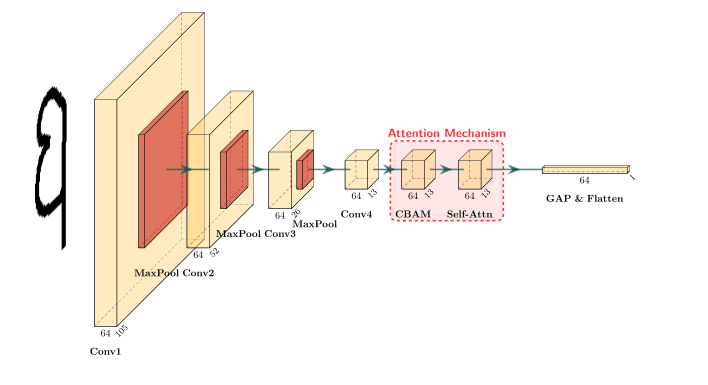

# ProtoNet-Omniglot

基于 Omniglot 数据集的小样本字符识别项目，包含三种少样本学习模型的 PyTorch 训练实现，以及一个配套的跨平台桌面推理应用。

## 项目结构

```
ProtoNet-Omniglot/
├── training/                        # Jupyter 训练 Notebook
│   ├── prototypical_net.ipynb       # 标准原型网络（ProtoNet）
│   ├── prototypical_net_cbam_sa.ipynb  # 注意力增强版 ProtoNet（+CBAM+SA）
│   └── siamese_net.ipynb            # 孪生网络（SiameseNet）
├── models/                          # 训练好的模型权重与元数据
│   ├── ProtoNet_5_1/                # 5-way 1-shot
│   ├── ProtoNet_5_5/                # 5-way 5-shot
│   ├── ProtoNet_CBAM_SA_5_1/        # 注意力增强，5-way 1-shot
│   ├── ProtoNet_CBAM_SA_5_5/        # 注意力增强，5-way 5-shot
│   ├── SiameseNet_5_1/              # 孪生网络，5-way 1-shot
│   └── SiameseNet_5_5/              # 孪生网络，5-way 5-shot
├── fewshot-char-system/             # 桌面推理应用（Tauri + React + Python）
├── requirements.txt                 # Python 训练环境依赖
└── LICENSE
```

## 模型介绍

本项目实现了三种少样本学习架构，均基于 **CNN-4** 编码器提取 64 维嵌入向量，并在 Omniglot 数据集上以情景式训练范式进行训练。

### 模型对比

| 模型 | 编码器 | 分类方式 | 训练损失 |
|------|--------|----------|----------|
| **ProtoNet** | CNN-4 | 负平方欧氏距离到原型 | CrossEntropyLoss |
| **ProtoNet CBAM SA** | CNN-4 + CBAM + Self-Attention | 负平方欧氏距离到原型 | CrossEntropyLoss |
| **SiameseNet** | CNN-4 | 负欧氏距离到 Support 样本均值 | ContrastiveLoss |

### 性能指标（5-way，测试集 1024 批次）

| 模型 | 配置 | 测试准确率 | 测试损失 |
|------|------|------------|----------|
| ProtoNet | 5-way 1-shot | 91.40% | 0.3461 |
| ProtoNet | 5-way 5-shot | 96.49% | 0.1490 |
| ProtoNet CBAM SA | 5-way 1-shot | 93.15% | 0.3001 |
| ProtoNet CBAM SA | 5-way 5-shot | **97.67%** | 0.2024 |
| SiameseNet | 5-way 1-shot | 80.00% | — |
| SiameseNet | 5-way 5-shot | 89.45% | — |

### 模型架构

#### CNN-4 编码器（ProtoNet / SiameseNet）

```
Conv2d(1→64, 3×3) + BN + ReLU + MaxPool2d(2)
Conv2d(64→64, 3×3) + BN + ReLU + MaxPool2d(2)
Conv2d(64→64, 3×3) + BN + ReLU + MaxPool2d(2)
Conv2d(64→64, 3×3) + BN + ReLU + AdaptiveAvgPool2d(1)
Flatten → 64 维嵌入向量
```

#### CNN-4-CBAM-SA 编码器（ProtoNet CBAM SA）

在 CNN-4 的第 4 个卷积块后串联两个注意力模块：

- **CBAM**：通道注意力（全局 Avg/Max Pool + 共享 MLP）+ 空间注意力（7×7 卷积）
- **Self-Attention**：多头自注意力（4 头，Pre-Norm，可学习位置编码，残差连接）

空间尺寸演变：105 → 52 → 26 → **13**（Self-Attention 的 `spatial_size=13`）



## 训练环境配置

### 依赖安装

需要 CUDA 12.6 环境。使用 [uv](https://github.com/astral-sh/uv) 或 pip 安装：

```powershell
pip install -r requirements.txt
```

> **Python 版本**：训练环境使用 Python 3.14。

### 数据集准备

下载数据集 [Omniglot](https://github.com/brendenlake/omniglot)，并按以下路径放置（相对于项目根目录）：

```
omniglot/
└── python/
    ├── images_background/   # 训练/验证集（background set）
    └── images_evaluation/   # 测试集（evaluation set）
```

## 训练流程

在 `training/` 目录下有三个独立的 Jupyter Notebook，分别对应三种模型：

| Notebook | 模型 | 输出目录 |
|----------|------|----------|
| `prototypical_net.ipynb` | ProtoNet | `models/ProtoNet_5_{k_shot}/` |
| `prototypical_net_cbam_sa.ipynb` | ProtoNet CBAM SA | `models/ProtoNet_CBAM_SA_5_{k_shot}/` |
| `siamese_net.ipynb` | SiameseNet | `models/SiameseNet_5_{k_shot}/` |

### 训练超参数

| 参数 | ProtoNet / CBAM SA | SiameseNet |
|------|-------------------|------------|
| n_way | 5 | 5 |
| k_shot | 1 或 5 | 1 或 5 |
| q_query | 5 | 5 |
| train_batches | 512 | 128 |
| val_batches | 512 | 128 |
| max_epochs | 250 | 250 |
| 早停耐心 | 25 | — |
| 优化器 | AdamW (lr=0.01) | AdamW (lr=0.001) |
| 损失函数 | CrossEntropyLoss | ContrastiveLoss (margin=0.2) |
| LR 调度 | ReduceLROnPlateau (patience=5) | 无 |

### 数据划分

Notebook 首次运行时，会从 `images_background` 中随机抽取 **20%** 的字母表移入 `val/` 作为验证集，其余 80% 移入 `train/`，该划分操作具有幂等性，仅首次运行时执行。

### 模型导出

训练完成后，每个 Notebook 会自动将模型导出为 **PyTorch ATen 独立图格式**（`.pt2`），支持动态 batch 维度：

- `encoder.pt2`：特征编码器
- `protonet-classifier.pt2` / `siamesenet-classifier.pt2`：分类器

同时生成：
- `best_encoder.pth` / `last_encoder.pth`：PyTorch 权重文件
- `meta.json`：模型元数据（含完整训练日志）
- `loss_curve.png/svg`、`accuracy_curve.png/svg`：训练可视化
- `t-sne.png/svg`：嵌入空间 t-SNE 可视化

## 桌面推理应用

`fewshot-char-system/` 是一个基于 **Tauri + PyTauri** 的跨平台桌面应用，提供图形界面进行实时字符识别。详见 [fewshot-char-system/README.md](./fewshot-char-system/README.md)。

## License

[Apache-2.0](./LICENSE)
